<p align="center">
  
</p>

<p align="center">
  <a href="https://linkedin.com/in/niyitegeka-remy-tresor-13189225b"></a>
  <a href="mailto:niyitegekatresor@gmail.com"></a>
  <a href="https://github.com/bee-ai-labs/bee"></a>
  
</p>

```ts
const remy = {
  role:     "Full-Stack Engineer",
  speaks:   ["TypeScript", "Python", "Go", "Java", "Dart", "C/C++"],
  builds:   ["web", "mobile", "APIs", "data pipelines", "AI systems"],
  founded:  "🐝 Bee — the open-source AI knowledge hive",
  motto:    "everything runs, no placeholders",
};
```

<p align="center">
  
</p>

## ⚔️ The Full-Stack Arcs
<sub>click an arc to expand it ↓</sub>

<details open>
<summary><b>⚡ Arc I · Frontend</b> — interfaces that feel instant</summary>
<br/>


- TypeScript-first web apps with **React** and **Next.js**, plus **Angular** where it fits
- Component systems, routing, data fetching and state that stays predictable
</details>

<details>
<summary><b>📱 Arc II · Mobile</b> — one codebase, two stores</summary>
<br/>


- Cross-platform iOS & Android apps with **React Native** and **Flutter / Dart**
- Shared logic with the web side wherever the stack allows it
</details>

<details>
<summary><b>🛠️ Arc III · Backend & APIs</b> — the engine room</summary>
<br/>


- REST APIs and services in **Node / Express**, **FastAPI**, **Django**, **Go** and **Java**
- Auth, data modelling and ORMs (**Prisma**) behind clean, typed contracts
</details>

<details>
<summary><b>🗄️ Arc IV · Data Engineering</b> — moving data you can trust</summary>
<br/>


- ETL pipelines in **Python** (pandas) and **SQL**, from raw sources to clean, queryable models
- Relational and document stores: **Postgres**, **MySQL**, **MongoDB**, **Supabase**, **Firebase**
</details>

<details>
<summary><b>🧠 Arc V · AI / ML</b> — models that ship</summary>
<br/>


- Training and serving models with **PyTorch**, **TensorFlow** and **scikit-learn**; vision with **OpenCV**
- LLM apps: prompt engineering, **RAG**, and agents (MCP, multi-agent)
</details>

<details>
<summary><b>☁️ Arc VI · Cloud & DevOps</b> — from laptop to production</summary>
<br/>


- Deploying on **AWS**, **Vercel**, **DigitalOcean** and **Render**
- CI/CD with **GitHub Actions**: lint, test, build, ship
</details>

<details>
<summary><b>🔌 Side Quest · Embedded & Web3</b></summary>
<br/>


- Embedded systems in **C / C++**, and smart contracts in **Solidity**
</details>

## 🐝 Bee — Open-Source AI Knowledge Hive

> **MDN, but for AI engineering.** Runnable examples, clear theory and guided learning paths, built by the community.

<a href="https://github.com/bee-ai-labs/bee"></a>
<a href="https://bee.atomiq.rw"></a>
<a href="https://github.com/bee-ai-labs/bee/labels/good%20first%20issue"></a>

LLMs & transformers · prompt engineering · RAG · agents (MCP, multi-agent) · vision & speech · eval, security & deployment.<br/>
I set the roadmap and quality bar, review PRs, mentor first-time contributors, and maintain the CI/CD and the docs site.

## 🌆 Contributions in 3D

<p align="center">
  
</p>

<p align="center">
  
  
</p>
<p align="center">
  
</p>

<p align="center">
  
</p>
