<!-- ✨ Animated anime-style banner (custom SVG, lives in this repo) -->
<p align="center">
  
</p>

<p align="center">
  <a href="https://readme-typing-svg.demolab.com">
    
  </a>
</p>

<p align="center">
  <a href="https://linkedin.com/in/niyitegeka-remy-tresor-13189225b"></a>
  <a href="mailto:niyitegekatresor@gmail.com"></a>
  <a href="https://bee.atomiq.rw"></a>
  
</p>

---

### 🧋 whoami

```ts
const remy = {
  role:      "Full-Stack Developer",
  focus:     ["Web", "Machine Learning", "Embedded Systems"],
  building:  "🐝 Bee — the open-source AI knowledge hive",
  motto:     "everything runs, no placeholders",
  coffee:    Infinity,
};
```

I build across the stack — from **React / Next / Flutter** front-ends down to **FastAPI / Node / Django** back-ends, with detours into **ML (PyTorch, TensorFlow)** and **embedded C/C++**. I like clean systems, runnable examples, and helping people land their first open-source merge.

---

## 🐝 Bee — Open-Source AI Knowledge Hive

> **MDN, but for AI Engineering.** A community-driven library of modern AI knowledge with runnable examples, clear theory, and guided learning paths.

<p>
  <a href="https://github.com/bee-ai-labs/bee"></a>
  <a href="https://github.com/bee-ai-labs/bee/stargazers"></a>
  <a href="https://github.com/bee-ai-labs/bee/labels/good%20first%20issue"></a>
</p>

**Covers:** LLMs & transformers · Prompt engineering · RAG · AI agents (MCP, multi-agent) · Vision & speech · Eval, security & deployment.
**I run it by:** setting the roadmap & quality bar · reviewing PRs & mentoring first-timers · maintaining CI/CD, tested examples and the MkDocs site.

---

## 🛠️ Tech Stack

**Languages**


**Front-End**


**Back-End**


**Data & ML**


**Databases & Cloud**


---

## 📊 GitHub in Motion

<p align="center">
  
  
</p>

<p align="center">
  
</p>

<p align="center">
  
</p>

<p align="center">
  
</p>

---

<p align="center">
  
</p>
