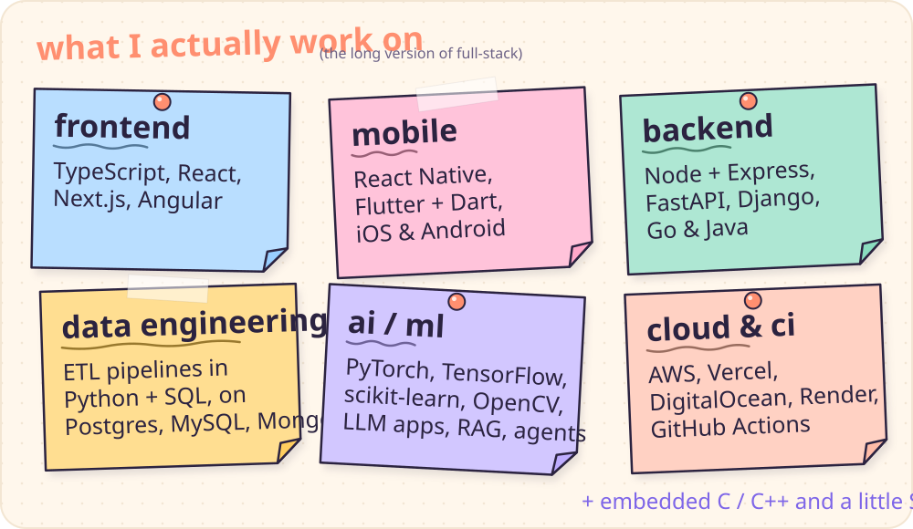
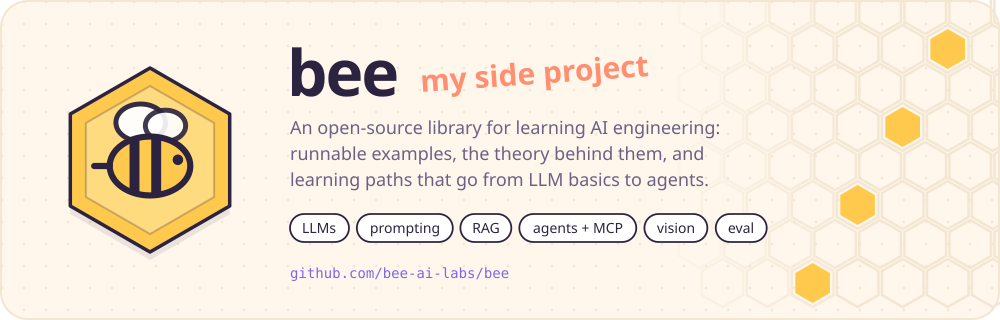

  

  <a href="https://linkedin.com/in/niyitegeka-remy-tresor-13189225b">linkedin</a> &nbsp;·&nbsp;
  <a href="mailto:niyitegekatresor@gmail.com">say hi</a> &nbsp;·&nbsp;
  <a href="https://github.com/bee-ai-labs/bee">bee</a>

  

  

  
   
  <a href="https://github.com/bee-ai-labs/bee">repo</a> &nbsp;·&nbsp; <a href="https://bee.atomiq.rw">docs</a> &nbsp;·&nbsp; <a href="https://github.com/bee-ai-labs/bee/labels/good%20first%20issue">good first issues</a>

  

<!-- years:start -->
<!-- years:end -->

  

