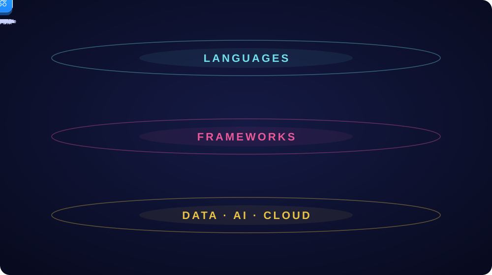

  

  <a href="https://linkedin.com/in/niyitegeka-remy-tresor-13189225b">linkedin</a> &nbsp;·&nbsp;
  <a href="mailto:niyitegekatresor@gmail.com">email</a> &nbsp;·&nbsp;
  <a href="https://github.com/bee-ai-labs/bee">bee</a>

 

I'm Remy. I build software end to end: web and mobile apps, the APIs and data pipelines behind them, and more and more often the models on top.

Most of my spare time goes into **[Bee](https://github.com/bee-ai-labs/bee)**, an open-source library for learning AI engineering.

 

  

<b>frontend</b>

 

TypeScript with React, Next.js and Angular.

<b>mobile</b>

 

React Native and Flutter, shipping to iOS and Android.

<b>backend</b>

 

APIs in Node and Express, FastAPI, Django, Go and Java.

<b>data engineering</b>

 

ETL pipelines in Python and SQL, on Postgres, MySQL, MongoDB, Supabase and Firebase.

<b>ai / ml</b>

 

PyTorch, TensorFlow, scikit-learn and OpenCV. LLM apps with retrieval and agents.

<b>cloud</b>

 

AWS, Vercel, DigitalOcean and Render, with CI on GitHub Actions.

<b>also</b>

 

Embedded C and C++, and some Solidity.

 

### bee

An open-source library for AI engineering: runnable examples, the theory behind them, and learning paths that go from LLM basics to agents. I set its direction, review pull requests, and help first-time contributors get their first merge.

[repo](https://github.com/bee-ai-labs/bee) &nbsp;·&nbsp; [docs](https://bee.atomiq.rw) &nbsp;·&nbsp; [good first issues](https://github.com/bee-ai-labs/bee/labels/good%20first%20issue)

 

  

  

